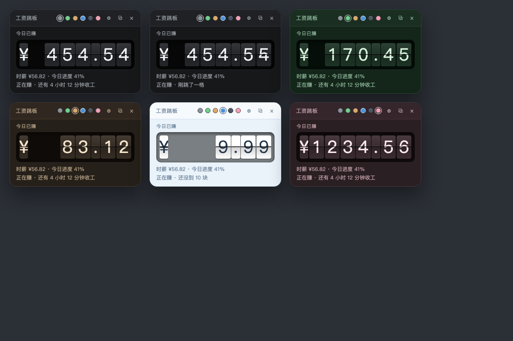

# 工资跳板 · Salary Flap

[](https://www.npmjs.com/package/dsh-salary-flap)
[](https://www.npmjs.com/package/dsh-salary-flap)
[](https://github.com/hulibuld/dsh-salary-flap)
[](LICENSE)

`dsh plugin --profile desktop add dsh-salary-flap` · [遇到问题开 issue](https://github.com/hulibuld/dsh-salary-flap/issues/new/choose)

一块挂在 DeepSeek 界面上的翻牌工资看板。填好月薪、每天几小时、每月几天、几点上班，它每 2 秒结算一次，用老式机场翻牌的动作把今天已经赚了多少钱翻给你看。

只算今天。上班前是 0，上班中按秒长，下班后封顶不动。



## 装

```
dsh plugin --profile desktop add dsh-salary-flap
```

或者让智能体装：`plugin_manager` → `action: install_bundle` → `target: dsh-salary-flap`。从本地目录装的话，target 换成你 clone 下来的目录。

装完刷新页面。看板默认落在窗口右下角。那一层是整帧浮层，本身不接鼠标事件，只有板子那一小块接收点击，不会挡住下面的界面。

## 用

第一次出来就是设置态，不用先找齿轮。填月薪、每天工作几小时、每月工作几天、上班时间（默认 `09:00`），点「开始跳」。

跑起来之后四件事。大号翻牌金额，下面一行小字写着时薪、今日进度和状态（还没上班 / 上班中 / 今天收工了）。按住板子顶部那块把手能拖走，位置记在本机。标题右边六个圆点是配色，黑白灰、护眼绿、原木黄、天空浅蓝、暗夜黑、樱花粉，点一下整套换掉。点右上角 ×，板子缩成会话顶栏上的一个金额胶囊，点它再展开。

界面默认中文，⚙ 里能切 English。

## 翻页

一块牌分上下两半，中缝是铰链。数字要变的时候，上半页绕下沿往前翻到 90°，翻到看不见的那一刻下半页从 90° 落回来落定，两段各 210ms，落定时有 6° 的过冲回弹。只有数值真的变了的格子会翻，进位从右往左错开 30ms，所以 `¥9.99 → ¥10.00` 读起来是一次进位，不是四个格子一起抖。

系统开了「减少动态效果」时翻页整个关掉，数字直接换。

## 算多少

```
日薪 = 月薪 / 每月工作天数
时薪 = 日薪 / 每日工作小时数
每 2 秒结算一次 = 时薪 / 1800
```

早于上班时间显示 `0.00`，状态「还没上班」，下面给倒计时。上班时间内按 `日薪 × 已过去的计薪秒数 / 当日总计薪秒数` 算。晚于下班时间封顶成日薪，状态「今天收工了」。

下班时间等于上班时间加每日工作小时数。结束时刻小于等于开始时刻时按跨午夜班次算，把现在归一到班次起点之后的偏移量再算进度。夜班从 22:00 上到 06:00，收工那刻就是这个日薪，之后一整天停在那儿，不会掉回 0。

金额一律截断到两位小数，不四舍五入，所以不会出现 `¥0.01` 反复跳，也不会先给多再扣回来。牌面固定 8 格，`¥` 加 4 位整数加小数点加 2 位小数。时间按本机时区算，不联网对时。

## 数据在哪

浏览器 `localStorage`，键前缀 `dsh.salary-flap.v1.`。`settings` 放月薪与工时，`pos` 放板子位置，`view` 放展开还是收在顶栏，`theme` 放配色，`lang` 放界面语言。

换浏览器、清缓存、换设备都不会跟着走。

## 已知限制

弹到系统桌面现在做不了，宿主里 `window.open` 直接被 deny，Electron 弹不出独立窗口。仓库里留了同款翻牌弹窗和一条开窗路由，宿主放开后把按钮加回去就能用。

不剔除午休，工作时长是连续的一段，中午那 1 小时也算在赚。只支持一份工作、一段班次，没有排班表。不做历史记录、图表、导出、声音、托盘、开机自启。同一个浏览器的两个标签页各算各的，不同步。

## 已知问题与修复记录

累计的修复、现象、原因与修法记在 [docs/FIXES.md](docs/FIXES.md)。以后每修一次加一行，别攒着。

## 许可

MIT。
