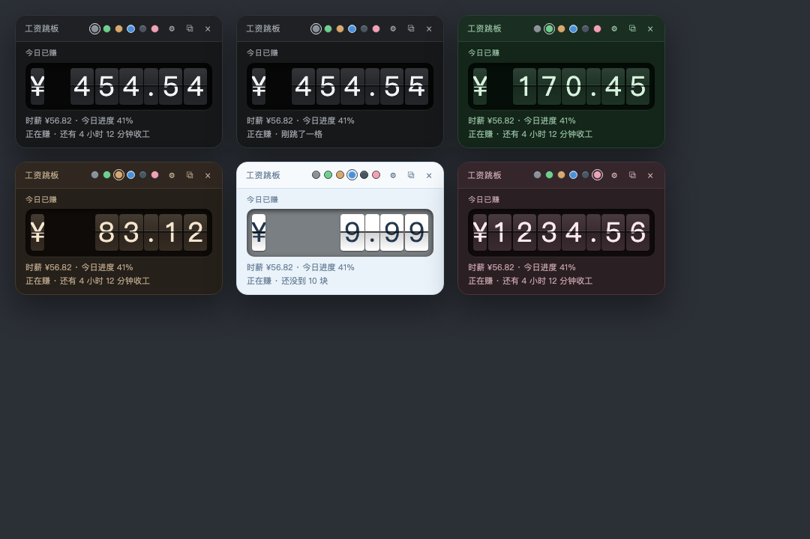
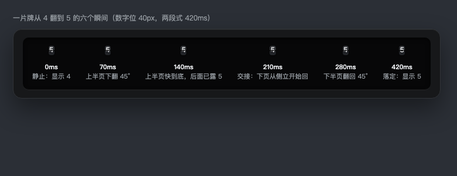

# 工资跳板 · Salary Flap

一块挂在 DeepSeek Harness 网页界面上的翻牌工资看板。填好月薪、每天几小时、每月几天、几点上班，它每 2 秒结算一次，用老式机场翻牌的动作把「今天已经赚了多少钱」翻给你看。



## 它解决什么

上班、写作业、备考的时候，时间是糊的，钱也是糊的。这块板子把两件事变成看得见的东西：一个数字在往上走，而且走得有质感——牌面翻下去、铰链咬住、落定，一格一格地进位。

只算今天。上班前是 0，上班中按秒长，下班后封顶不动。

## 装

它是 DSH 的 client 插件（bundle 形态），装在 `desktop` profile 里。两种装法选一个：

**从 npm 装**（包名 `dsh-salary-flap`；npm 页面刚发布时可能还没索引出来，装不上就先用下面第二种）：

```
plugin_manager → action: install_bundle → target: dsh-salary-flap
```

**从本地目录装**：

```
git clone https://github.com/hulibuld/dsh-salary-flap
plugin_manager → action: install_bundle → target: <你 clone 下来的目录>
```

装完刷新页面。看板默认落在窗口右下角（Client Slot `shell.overlay`，条目 id `salary-flap`）。这一层是整帧浮层，本身不接鼠标事件，只有板子那一小块接收点击，所以不会挡住下面的界面。

## 装完怎么用

第一次出来就是设置态，不用先找齿轮：直接填月薪、每天工作几小时、每月工作几天、上班时间（默认 `09:00`），点「开始跳」。

跑起来之后是四件事：

- 大号翻牌金额，下面一行小字写着时薪、今日进度和状态（还没上班 / 上班中 / 今天收工了）。
- **拖动**：按住板子顶部那块把手拖走，位置记在本机，下次还在那儿。
- **换配色**：标题右边六个圆点，黑白灰、护眼绿、原木黄、天空浅蓝、暗夜黑、樱花粉，点一下整套换掉，包括牌面和凹陷窗。
- **收进顶栏**：点右上角 `×`，板子缩成会话顶栏上的一个金额胶囊，点它再展开。不想看见它的时候，这一下就够。

界面默认中文，⚙ 里可以切 English。

## 翻页是怎么做的

一块牌分上下两半，中缝是铰链。数字要变的时候，上半页绕下沿往前翻到 90°，翻到看不见的那一刻下半页从 90° 落回来落定，两段各 210ms，总共 420ms，落定时有 6° 的过冲回弹。只有数值真的变了的格子会翻，进位从右往左错开 30ms，所以 `¥9.99 → ¥10.00` 读起来是一次进位，不是四个格子一起抖。



系统开了「减少动态效果」时，翻页整个关掉，数字直接换。

## 计算口径

```
日薪     = 月薪 / 每月工作天数
时薪     = 日薪 / 每日工作小时数
每 2 秒结算一次 = 时薪 / 1800
```

今天赚了多少：

| 现在的位置 | 显示 |
|---|---|
| 早于上班时间 | `0.00`，状态「还没上班」，下面给倒计时 |
| 上班时间内 | `日薪 × 已过去的计薪秒数 / 当日总计薪秒数` |
| 晚于下班时间 | `日薪`（封顶），状态「今天收工了」 |

- 下班时间 = 上班时间 + 每日工作小时数。结束时刻 ≤ 开始时刻时按**跨午夜班次**算：把「现在」归一到班次起点之后的偏移量再算进度。夜班从 22:00 上到 06:00，收工那刻就是这个日薪，之后一整天都停在那儿，不会掉回 0。
- 金额一律**截断**到两位小数，不四舍五入。所以不会出现 `¥0.01` 反复跳的错觉，也永远不会「先给多再扣回来」。
- 牌面固定 **8 格**：`¥` + 4 位整数 + 小数点 + 2 位小数。日薪到五位数才需要改这个排版。
- 时间按本机本地时区算，不联网对时。

## 数据存在哪

浏览器 `localStorage`，键前缀 `dsh.salary-flap.v1.`：

| 键 | 内容 |
|---|---|
| `settings` | 月薪、每天小时数、每月天数、上班时间 |
| `pos` | 板子位置 |
| `view` | 展开还是收在顶栏 |
| `theme` | 配色（mono / green / wood / sky / night / sakura） |
| `lang` | 界面语言（zh / en） |

换浏览器、清缓存、换设备都不会跟着走——它本来也没打算联网。

## 自检

仓库里带了一份自检，断言全部从源码里取，不维护第二份实现：

```bash
node tools/selfcheck.mjs
```

它会拿 `client.js` 里 `SF-PURE` 标记之间的真代码跑计算口径（含跨午夜、非法输入、全天 14401 个格点的截断一致性），再对 CSS 和弹窗做几何断言、核对中英文案键集是否对齐。97 项全过才退出 0。

## 已知限制

- **弹到系统桌面这件事现在做不了**：宿主环境里 `window.open` 被直接 deny，Electron 弹不出独立窗口。仓库里保留了 `window.html`（同款翻牌弹窗）和 `/plugins/dsh-salary-flap/open` 路由，宿主放开后把按钮加回去就能用。
- 不剔除午休：工作时长是连续的一段，中午那 1 小时也算在赚。
- 只支持一份工作、一段班次，没有排班表。
- 不做历史记录、图表、导出、声音、托盘、开机自启。
- 同一个浏览器的两个标签页各算各的，不同步。

## 反馈

Issues: <https://github.com/hulibuld/dsh-salary-flap/issues>

## 许可

MIT。
